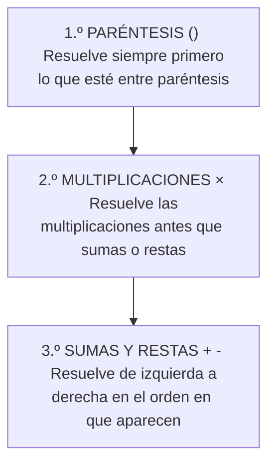

# 🔢 Matemáticas 4.º de Primaria
## Unidad 3: «La Multiplicación»
### Proyecto CLAVES / Construyendo Mundos · Grazalema–Santillana
**Alumna:** Olivia  
**Curso:** 4.º Educación Primaria  
**Materia:** Matemáticas  

---

## 🎯 Índice Conceptual y Saberes Básicos

Esta guía pedagógica resume de forma estructurada, amena y rigurosa todos los saberes básicos requeridos para el control oficial del **Tema 3: La Multiplicación** (Proyecto *Construyendo Mundos*, Editorial Santillana), adaptada especialmente para Olivia con explicaciones paso a paso, ejemplos de la vida real y trucos para no caer en las preguntas trampa.

---

### 1. ¿Qué es Multiplicar y cuáles son sus Términos?

- **Multiplicar** es una forma rápida de sumar el mismo número varias veces (una suma de sumandos iguales).
  $$\underbrace{8 + 8 + 8 + 8 + 8 + 8}_{6 \text{ veces}} = 6 \times 8 = 48$$
- **Términos de la multiplicación:**
  - **Factores:** Son los números que se multiplican entre sí.
    - El primer factor suele indicar la cantidad que se repite (multiplicando).
    - El segundo factor indica cuántas veces se repite (multiplicador).
  - **Producto:** Es el resultado final de la multiplicación.
  $$\begin{matrix} & 125 & \leftarrow \text{Factor} \\ \times & 8 & \leftarrow \text{Factor} \\ \hline & 1.000 & \leftarrow \text{Producto} \end{matrix}$$

---

### 2. Multiplicaciones por Números de 1, 2 y 3 Cifras

#### A. Por una cifra con llevadas
1. Se multiplica el factor de abajo por las unidades, luego por las decenas, centenas, etc.
2. Las llevadas se suman a la cifra siguiente tras multiplicar (¡ojo: primero multiplicas y después sumas la que te llevas!).

#### B. Por dos cifras (El escalón a la izquierda)
1. Multiplicas el número de arriba por las **unidades** del factor de abajo.
2. Multiplicas el número de arriba por las **decenas** del factor de abajo, **dejando un hueco libre en las unidades** (o poniendo un 0) y empezando a escribir debajo de las decenas.
3. Sumas los dos productos intermedios.
   $$\begin{array}{r@{\quad}l} 354 & \\ \times \; 82 & \\ \hline 708 & \leftarrow (354 \times 2) \\ + \; 2832\phantom{0} & \leftarrow (354 \times 80) \\ \hline 29.028 & \leftarrow \text{Producto total} \end{array}$$

#### C. Factores con Ceros Intermedios
Si multiplicamos por un número con ceros en medio (por ejemplo, por $205$):
- Al multiplicar por la decena ($0$), no hace falta escribir una fila entera de ceros; saltamos directamente a las centenas desplazando dos lugares a la izquierda.

#### D. Multiplicación por la Unidad Seguida de Ceros y Ceros Finales
- Para multiplicar por $10, 100, 1.000$, se escribe el mismo número y se añaden **tantos ceros como ceros acompañen al 1**:
  - $1.305 \times 10 = 13.050$
  - $48 \times 100 = 4.800$
  - $72 \times 1.000 = 72.000$
- Si multiplicamos por números que terminan en ceros ($20, 200, 4.000$):
  - Multiplicamos los números sin los ceros y añadimos los ceros al final:
  - $109 \times 200 \implies 109 \times 2 = 218 \implies 21.800$
  - $25 \times 200 \implies 25 \times 2 = 50 \implies 5.000$

---

### 3. Las Tres Grandes Propiedades de la Multiplicación

| Propiedad | Definición | Regla Matemática | Ejemplo Práctico |
| :--- | :--- | :--- | :--- |
| **1. Conmutativa** | El orden de los factores no cambia el producto. | $a \times b = b \times a$ | $16 \times 6 = 6 \times 16 = 96$ |
| **2. Asociativa** | Para multiplicar tres números, podemos agrupar dos de ellos primero y el resultado multiplicarlo por el tercero. | $(a \times b) \times c = a \times (b \times c)$ | $(3 \times 10) \times 2 = 30 \times 2 = 60$ $3 \times (10 \times 2) = 3 \times 20 = 60$ |
| **3. Distributiva** | Para multiplicar un número por una suma (o resta), se multiplica ese número por cada término y luego se suman (o restan) los resultados. | $a \times (b + c) = (a \times b) + (a \times c)$ $(b - c) \times a = (b \times a) - (c \times a)$ | $2 \times (8 + 5) = (2 \times 8) + (2 \times 5) = 16 + 10 = 26$ $(82 - 15) \times 3 = (82 \times 3) - (15 \times 3) = 246 - 45 = 201$ |

#### 💡 Truco de Olivia para la Propiedad Distributiva en Cálculo Mental:
¿Cuánto es $7 \times 43$?
- Descomponemos $43$ en $40 + 3$:
  $$7 \times 43 = 7 \times (40 + 3) = (7 \times 40) + (7 \times 3) = 280 + 21 = 301$$

---

### 4. Estimación de Productos (Redondeos Rápidos)

Para estimar un producto cuando no necesitamos el resultado exacto o para comprobar mentalmente si un cálculo tiene sentido:
1. **Identificamos el factor que tiene más cifras** (o redondeamos a la decena/centena más cercana).
2. **Aplicamos la regla del redondeo:**
   - Si la cifra de la derecha es **$5, 6, 7, 8$ o $9$**, aumentamos en 1 la cifra a la que redondeamos.
   - Si la cifra de la derecha es **$0, 1, 2, 3$ o $4$**, la cifra se queda igual.
3. Multiplicamos el número redondeado por el otro factor.

**Ejemplos Oficiales de Examen:**
- *¿Cuántos yogures se venderán en 7 días si cada día se venden 96 paquetes?*
  - Redondeamos $96$ a las centenas: $96 \to 100$.
  - Estimamos paquetes en una semana: $100 \times 7 = 700$ paquetes estimados.
  - Como cada paquete tiene 8 yogures: $700 \times 8 \approx 5.600$ yogures.
- *¿Cuántos paquetes de leche (de 6 briks) hacen falta para tener unos 1.200 briks?*
  - $1.200 : 6 = 200$ paquetes aproximadamente.

---

### 5. Jerarquía Sagrada de las Operaciones Combinadas

Cuando en un mismo problema o ejercicio aparecen varias operaciones juntas ($+$, $-$, $\times$ y paréntesis):

#### Ejemplos Resueltos Paso a Paso:
1. **Con paréntesis:**
   $$24 \times (3 \times 6) = 24 \times 18 = 432$$
   $$(96 + 17) \times 6 = 113 \times 6 = 678$$
   $$(2 \times 24) - (15 + 14) = 48 - 29 = 19$$
2. **Sin paréntesis (¡Cuidado con la trampa!):**
   $$5 + 3 \times 8 = 5 + 24 = 29 \quad (\text{¡NUNCA } 8 \times 8!)$$

---

### 6. Problemas Reales de Almacén y Logística (Modelo de Examen)

1. **Problema de Reparto y Stock Inicial:**
   *En el almacén ya había 17 cajas de 6 briks de zumo. Llega una furgoneta con 96 cajas más de 6 briks.*
   - Forma 1: $(17 + 96) \times 6 = 113 \times 6 = 678$ briks.
   - Forma 2 (Distributiva): $(17 \times 6) + (96 \times 6) = 102 + 576 = 678$ briks.
2. **Problema de Existencias y Consumo:**
   *Valentina tenía 2 paquetes de 24 rollos de papel ecológico. Lleva 15 a su autocaravana y gasta 14 en el taller.*
   - Operación combinada: $(2 \times 24) - 15 - 14 = 48 - 15 - 14 = 33 - 14 = 19$ rollos.
   - O también: $(2 \times 24) - (15 + 14) = 48 - 29 = 19$ rollos.

---

### 7. Preguntas Trampa Típicas de Examen Santillana CLAVES

1. **¿Qué propiedad se aplica en $25 \times 200 = 200 \times 25$?**  
   👉 **Propiedad Conmutativa** (cambia el orden de los factores, el resultado sigue siendo $5.000$).
2. **¿Qué propiedad se aplica en $(3 \times 10) \times 2 = 3 \times (10 \times 2)$?**  
   👉 **Propiedad Asociativa** (cambia la agrupación con los paréntesis, el resultado sigue siendo $60$).
3. **¿Qué propiedad se aplica en $(82 - 15) \times 3 = (82 \times 3) - (15 \times 3)$?**  
   👉 **Propiedad Distributiva respecto de la resta**.
4. **Si multiplico $109 \times 200$, ¿cuántos ceros tendrá el final del resultado?**  
   👉 Tiene 2 ceros ($109 \times 2 = 218 \to 21.800$).
5. **En la operación $10 + 4 \times 5$, ¿qué se hace primero?**  
   👉 **Primero la multiplicación**: $4 \times 5 = 20$, luego $10 + 20 = 30$. (Hacer $14 \times 5$ es un error grave).
